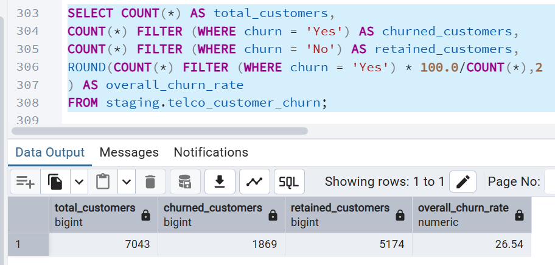
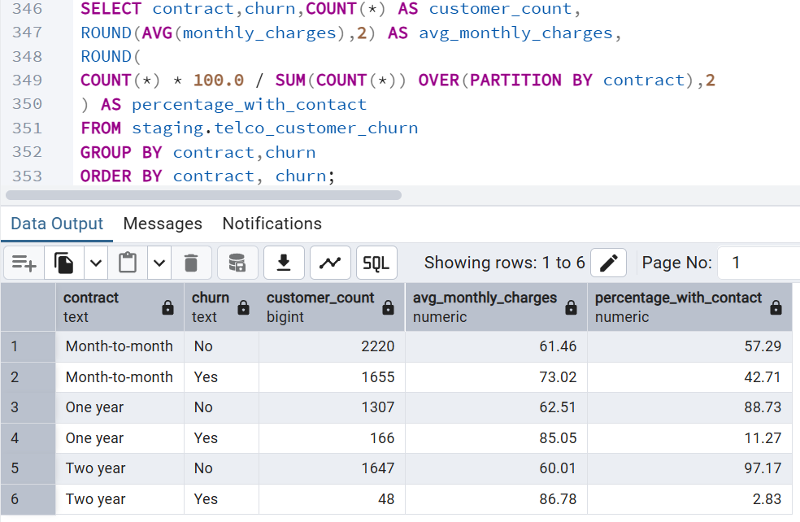
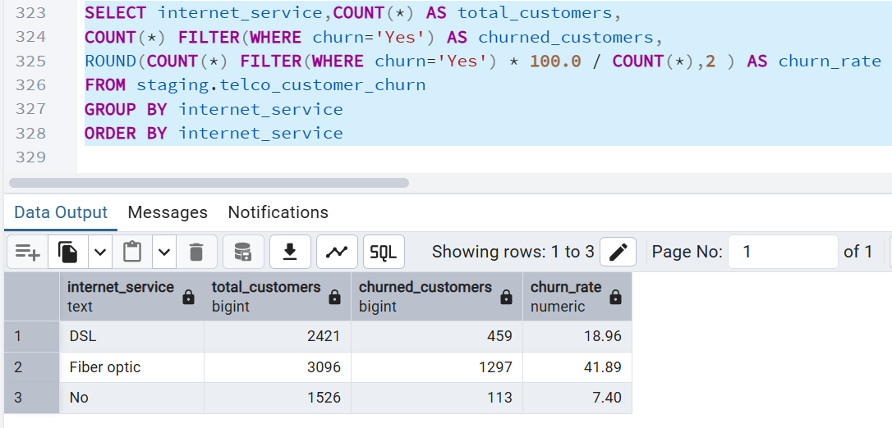
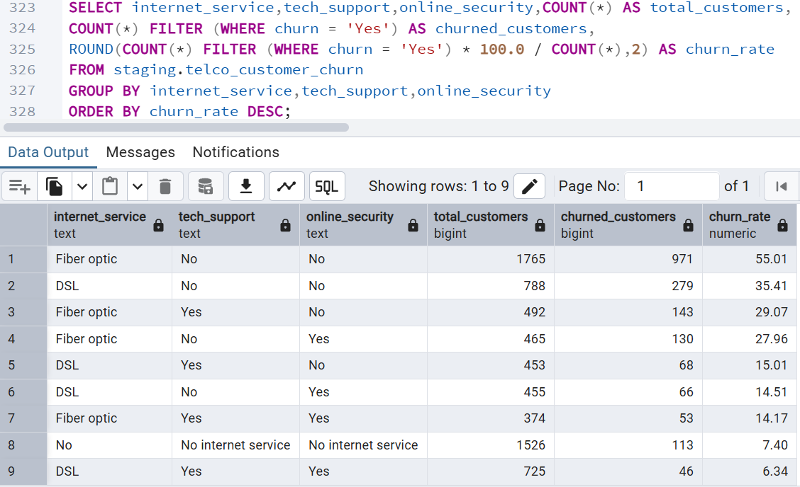
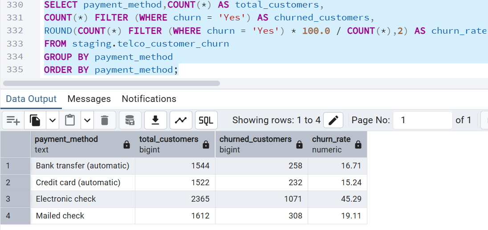
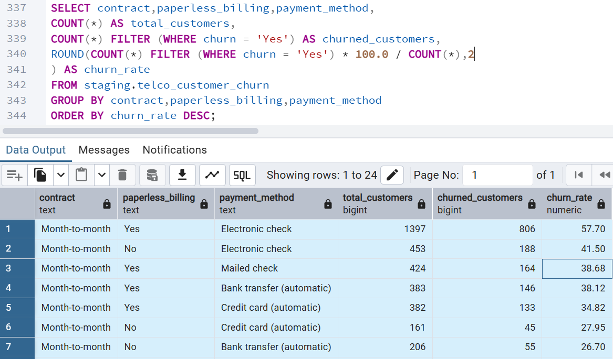

# Telco Customer Churn Analysis | PostgreSQL

## Project Overview

Customer churn is a major challenge for subscription-based businesses. Understanding why customers leave helps businesses identify high-risk customer segments and make better retention decisions.

This project focuses on analyzing customer churn using **PostgreSQL** and the IBM Telco Customer Churn dataset. It covers data ingestion, data cleaning, data quality validation, exploratory analysis, and business-focused SQL investigations to identify patterns associated with customer churn.

The analysis explores customer demographics, contract types, internet services, monthly charges, payment methods, and additional services to understand how these factors relate to customer churn.

## Business Objectives

- Measure the overall customer churn rate.
- Identify customer segments with higher churn rates.
- Analyze the relationship between contract types and customer churn.
- Understand how internet services and additional support services relate to churn.
- Investigate the relationship between payment methods, paperless billing, and churn.
- Identify combinations of customer attributes associated with higher churn.

## Dataset

**Dataset:** Telco Customer Churn

**Source:** [Kaggle – Telco Customer Churn Dataset](https://www.kaggle.com/datasets/blastchar/telco-customer-churn)

| Dataset Details | Value |
|---|---:|
| Total Records | 7,043 |
| Total Columns | 21 |
| Database | PostgreSQL |
| Raw Table | `raw.telco_customer_churn` |
| Staging Table | `staging.telco_customer_churn` |

The dataset contains customer information, account details, subscribed services, billing information, and churn status.

Refer to [`Data/readme.md`](Data/readme.md) for dataset download instructions.

## Tech Stack

- **Database:** PostgreSQL
- **Query Language:** SQL
- **Version Control:** Git and GitHub

### SQL Concepts Used

- Data cleaning and type conversion
- NULL handling using `NULLIF` and `TRIM`
- Aggregate functions
- Conditional aggregation using `FILTER`
- `CASE WHEN` statements
- Common Table Expressions (CTEs)
- Window functions
- Data grouping and segmentation
- Data quality checks and validation

## Project Workflow

### 1. Data Ingestion

- Imported the original CSV dataset into PostgreSQL.
- Created a raw data layer.
- Imported all raw columns as `TEXT` to avoid data type conversion issues during ingestion.

### 2. Data Cleaning and Transformation

- Created a staging table from the raw table.
- Removed leading and trailing whitespace using `TRIM`.
- Converted blank values into `NULL` using `NULLIF`.
- Converted numeric columns into appropriate data types.
- Retained all 7,043 customer records.

### 3. Data Quality Validation

Performed data quality checks to validate:

- Raw and staging record counts.
- Duplicate customer IDs.
- Missing values.
- Numeric data ranges.
- Distinct categorical values.

**Data quality results:**

| Validation | Result |
|---|---:|
| Raw Records | 7,043 |
| Staging Records | 7,043 |
| Duplicate Customer IDs | 0 |
| Missing `TotalCharges` Values | 11 |
| Minimum Tenure | 0 months |
| Maximum Tenure | 72 months |

The 11 blank `TotalCharges` values were converted to `NULL`. No customer records were deleted.

### 4. Exploratory Data Analysis

Performed initial analysis to understand the overall distribution of customer churn and establish a baseline churn rate.

### 5. Business Analysis

Developed 17 SQL investigations covering:

1. Gender and customer churn.
2. Monthly and total charges by churn status.
3. Contract type and customer churn.
4. Monthly charge segmentation by contract type.
5. Tenure segmentation by contract type.
6. Internet service and customer churn.
7. Internet service combined with contract type.
8. Online security and customer churn.
9. Internet service combined with online security.
10. Tech support and customer churn.
11. Internet service combined with tech support.
12. Internet service, tech support, and online security.
13. Payment method and customer churn.
14. Contract type combined with payment method.
15. Paperless billing and customer churn.
16. Paperless billing combined with payment method.
17. Contract type, paperless billing, and payment method.

## Key Business Insights

### 1. Overall Customer Churn

Out of 7,043 customers, 1,869 customers have churned.

| Metric | Value |
|---|---:|
| Total Customers | 7,043 |
| Churned Customers | 1,869 |
| Retained Customers | 5,174 |
| Overall Churn Rate | 26.54% |

Approximately one in four customers in the dataset has churned.

### 2. Contract Type and Churn

Month-to-month customers have a considerably higher churn rate than customers on longer-term contracts.

| Contract Type | Churn Rate |
|---|---:|
| Month-to-month | 42.71% |
| One year | 11.27% |
| Two year | 2.83% |

### 3. Internet Service and Churn

Fiber optic customers have the highest churn rate among the internet service categories.

| Internet Service | Churn Rate |
|---|---:|
| Fiber optic | 41.89% |
| DSL | 18.96% |
| No internet service | 7.40% |

### 4. Additional Services and Churn

Customers without online security and tech support show higher churn rates.

The combination of Fiber optic internet, no tech support, and no online security has a churn rate of 55.01%.

### 5. Payment Method and Churn

Electronic check customers have the highest churn rate among the payment methods.

| Payment Method | Churn Rate |
|---|---:|
| Electronic check | 45.29% |
| Mailed check | 19.11% |
| Bank transfer (automatic) | 16.71% |
| Credit card (automatic) | 15.24% |

### 6. Combined Customer Segmentation

The combination of month-to-month contracts, paperless billing, and electronic check payments represents a high-churn customer segment.

- Total Customers: 1,397
- Churned Customers: 806
- Churn Rate: 57.70%

These findings highlight customer groups that may deserve further investigation for retention strategies.

## SQL Analysis Screenshots

The following screenshots demonstrate selected SQL investigations and their actual query results.

### 1. Overall Customer Churn



### 2. Contract Type vs Customer Churn



### 3. Internet Service vs Customer Churn



### 4. Tech Support and Online Security



### 5. Payment Method vs Customer Churn



### 6. Combined Customer Segment Analysis



## Repository Structure

```text
telecom-customer-churn-analysis/
│
├── data/
│   └── README.md
│
├── sql/
│   ├── data_setup_and_quality.sql
│   ├── exploratory_analysis.sql
│   └── business_analysis.sql
│
├── docs/
│   ├── business_insights.md
│   ├── data_dictionary.md
│   └── methodology.md
│
├── outputs/
│   └── SQL query result CSV files
│
├── Output_Screenshots/
│   └── SQL analysis screenshots
│
├── README.md
└── .gitignore
```

## How to Run This Project

1. Install PostgreSQL and open your preferred PostgreSQL client.
2. Download the dataset from the Kaggle source provided above.
3. Create the raw schema and table using `sql/data_setup_and_quality.sql`.
4. Import the original CSV data into `raw.telco_customer_churn`.
5. Execute `sql/data_setup_and_quality.sql` to create the staging table and perform data quality checks.
6. Run `sql/exploratory_analysis.sql` to understand the overall customer churn distribution.
7. Execute `sql/business_analysis.sql` to reproduce the 17 business investigations.
8. Review the documentation and query results in the `docs/` and `outputs/` directories.

## Project Limitations

- The analysis is based on the available historical dataset.
- The findings represent associations and patterns, not proven causes of customer churn.
- The analysis does not use predictive machine learning models.
- Further investigation would be required before implementing customer retention strategies.

## Conclusion

This project demonstrates how PostgreSQL can be used to transform raw customer data into structured, validated, and business-focused insights.

Through data preparation, quality validation, exploratory analysis, and 17 business investigations, the project identifies customer segments associated with higher churn rates.

The analysis provides a foundation for understanding customer behavior and supporting data-driven retention decisions.
